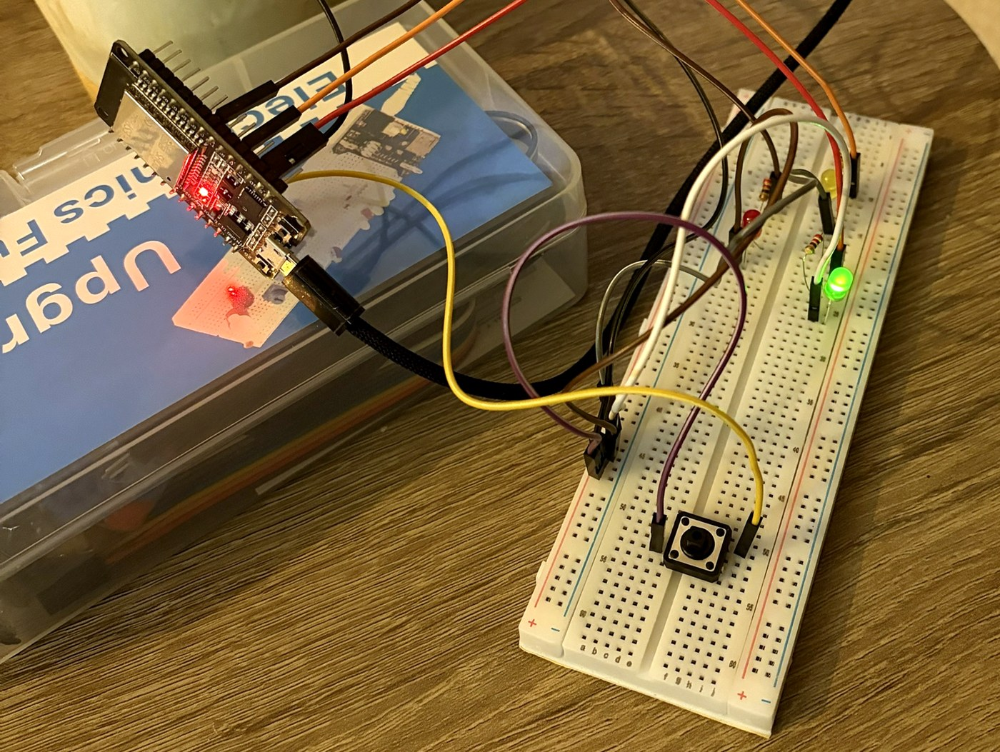
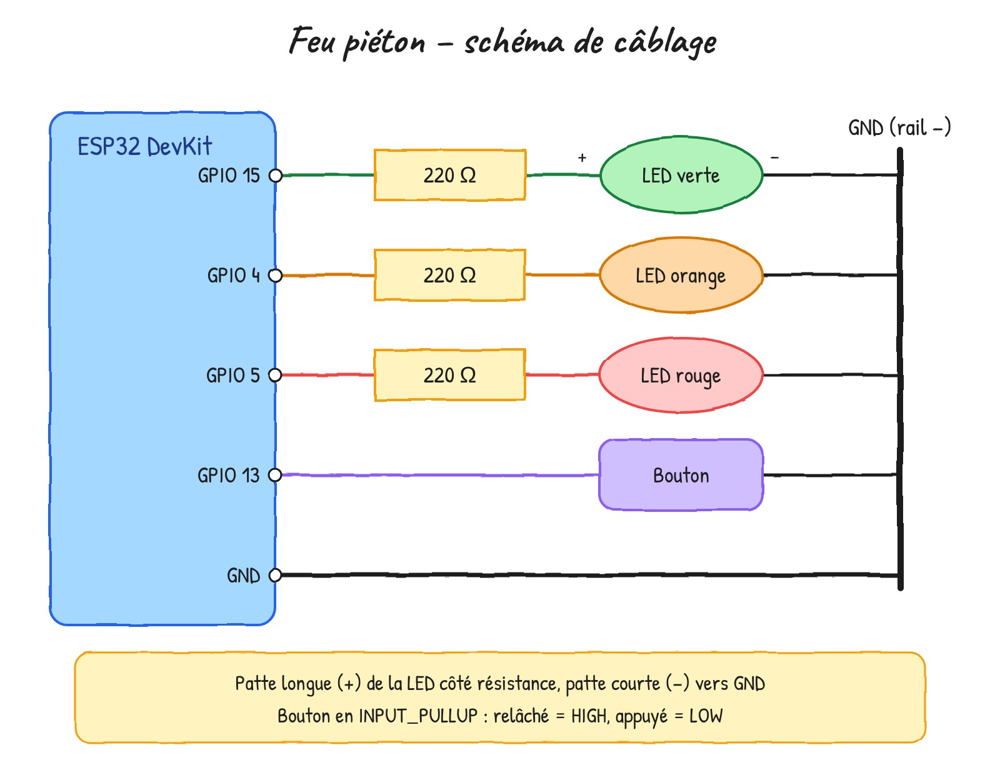

# 🚦 Feu piéton

Mon premier projet sur mon ESP32 : un feu tricolore avec bouton piéton.
Le feu reste vert. Quand on appuie sur le bouton, il passe à l'orange (1 s),
puis au rouge (3 s) pour laisser traverser, puis revient au vert.

## Ce que j'ai appris
- La structure d'un programme Arduino : `setup()` et `loop()`
- Nommer ses broches avec des constantes (`const int`)
- Piloter des sorties avec `digitalWrite` et lire une entrée avec `digitalRead`
- Utiliser un bouton avec `INPUT_PULLUP` (appuyé = LOW, relâché = HIGH)
- Attendre un événement avec une boucle `while`

## Matériel
- ESP32 DevKit (30 broches)
- 3 LED (verte, orange, rouge) + 3 résistances de 220 Ω
- 1 bouton poussoir
- Breadboard et câbles Dupont

## Câblage

| Composant | Broche ESP32 |
|---|---|
| LED verte (+ 220 Ω) | GPIO 15 |
| LED orange (+ 220 Ω) | GPIO 4 |
| LED rouge (+ 220 Ω) | GPIO 5 |
| Bouton | GPIO 13 et GND |
| Cathodes des LED | GND (rail −) |

## Problèmes rencontrés
- **Le bouton était détecté comme appuyé en permanence.** Ses pattes sont
  reliées deux par deux à l'intérieur. Mal orienté sur la breadboard, une
  colonne court-circuitait le bouton. Solution : tourner le bouton et
  brancher les fils sur deux pattes en diagonale.
- **Le feu ne réagissait pas au bouton.** J'avais écrit
  `while (BOUTON == HIGH)` : `BOUTON` vaut juste 13, il faut lire son état
  avec `digitalRead(BOUTON)`.
- **Toutes les LED restaient allumées.** Il faut éteindre la LED précédente
  (`LOW`) avant d'allumer la suivante.