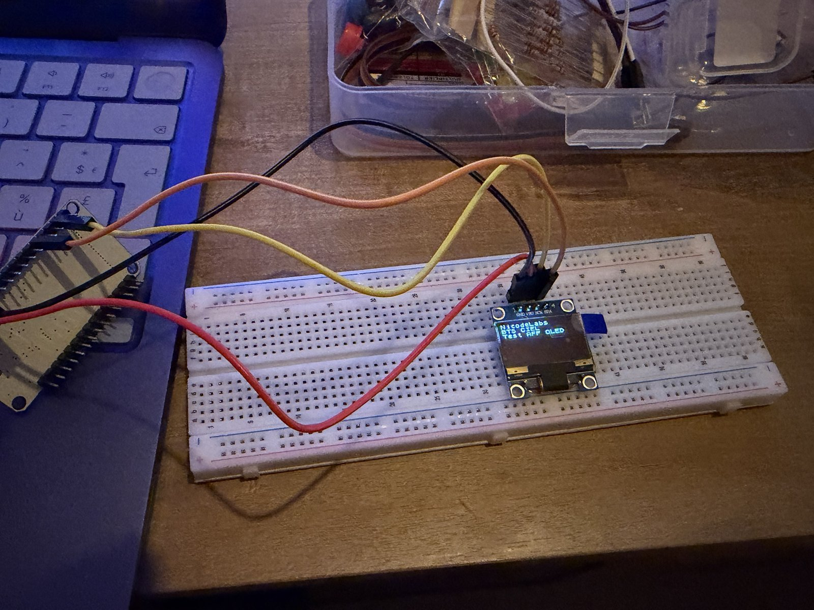
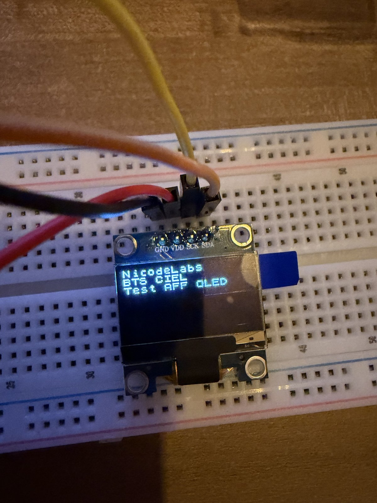

# 02 – Affichage sur écran OLED (I2C)

Ce projet affiche du texte sur un petit écran OLED branché à un ESP32 : « NicodeLabs », « BTS CIEL » et « Test AFF OLED », sur trois lignes.

## Matériel
- ESP32 Dev Module
- Écran OLED 0,96" SSD1306 (128x64), en I2C
- Breadboard + 4 fils

## Câblage
| Écran OLED | ESP32   |
|------------|---------|
| GND        | GND     |
| VDD        | 3,3 V   |
| SCK        | GPIO 22 |
| SDA        | GPIO 21 |

## Bibliothèque
- `ACROBOTIC_SSD1306` (installée depuis le gestionnaire de bibliothèques de l'Arduino IDE)

## Comment ça marche
L'I2C est un protocole de communication qui permet de brancher plusieurs modules sur les 2 mêmes fils, SDA et SCL. SDA transporte les données (ici : ce que l'écran doit afficher et où) et SCL est l'horloge qui donne le rythme pour que l'écran sache quand lire chaque bit. L'ESP32 communique