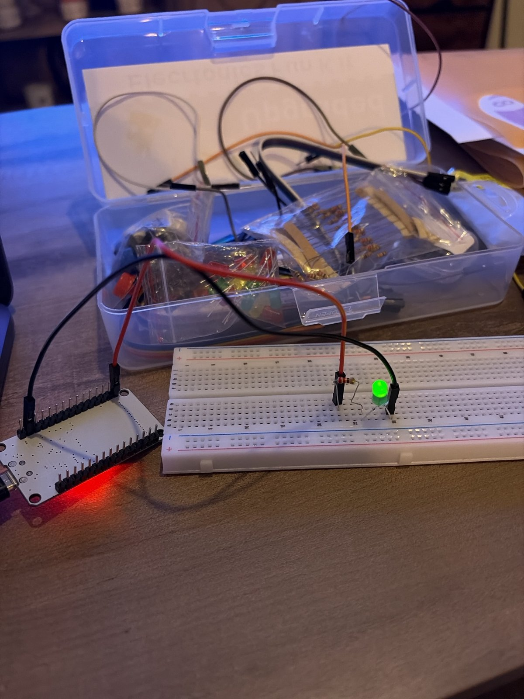
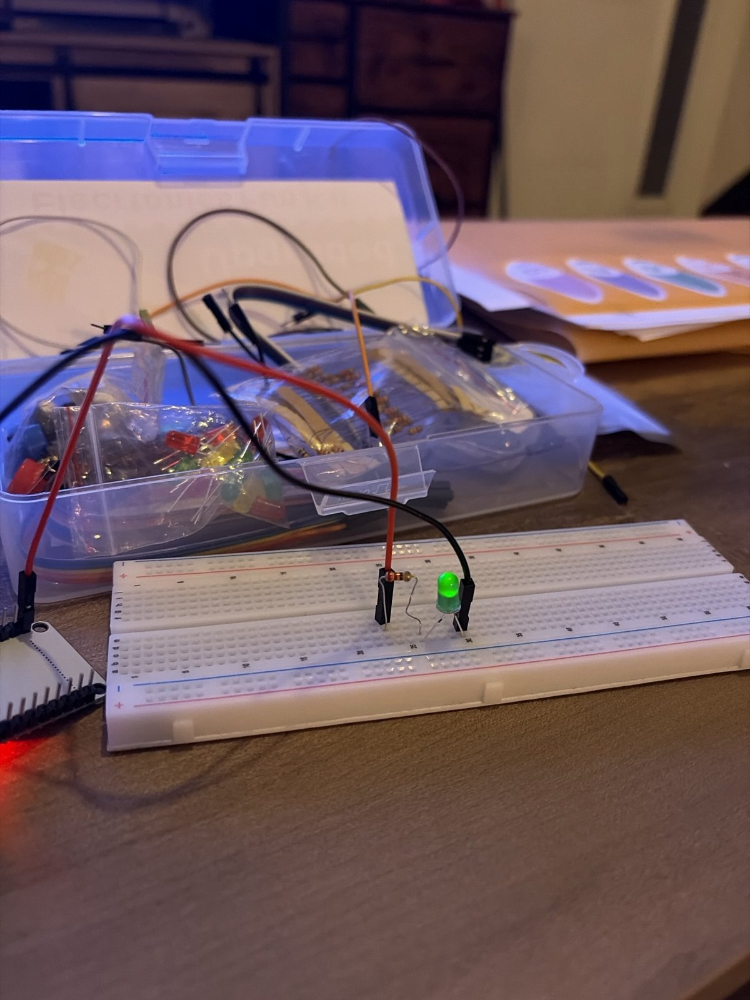

# 03 – LED qui s'allume progressivement (PWM)

Ce projet fait s'allumer une LED progressivement, de éteinte à pleine lumière en environ 4 secondes, puis elle s'éteint d'un coup et recommence.

## Matériel
- ESP32 Dev Module
- 1 LED verte
- 1 résistance
- Breadboard + 2 fils

## Câblage
| Composant | Branchement |
|---|---|
| GPIO 23 de l'ESP32 | Résistance |
| Résistance | Patte longue (+, anode) de la LED |
| Patte courte (−, cathode) de la LED | GND de l'ESP32 |

## Comment ça marche
**La résistance** : une LED n'a presque pas de résistance. Sans résistance, le courant serait trop fort et la LED grillerait. La résistance limite le courant.

**Le sens de la LED** : la patte longue (+) va côté résistance, la patte courte (−) va côté GND.

**Le PWM** : le PWM fait clignoter la LED très très vite, tellement vite qu'on ne le voit pas à l'œil nu : on voit juste une luminosité moyenne. Le rapport cyclique (de 0 à 255 sur 8 bits) règle la part du temps où la LED est allumée : plus il est grand, plus la LED paraît forte.

**Le code** : la boucle `for` fait passer le rapport cyclique de 0 à 255, avec une pause de 15 ms entre chaque pas. La LED reste un peu plus longtemps allumée à chaque tour, donc elle paraît de plus en plus forte.

## Ce que j'ai appris / ce qui m'a bloqué
Au début, je pensais que le PWM était une impulsion qui montait de 0 à 255. En fait, c'est ma boucle qui fait monter la valeur. Le PWM, lui, fait clignoter la LED très vite, et la valeur règle combien de temps elle reste allumée. J'ai aussi appris à calculer le pourcentage : valeur ÷ 255 (ex : 192 ≈ 75 %).