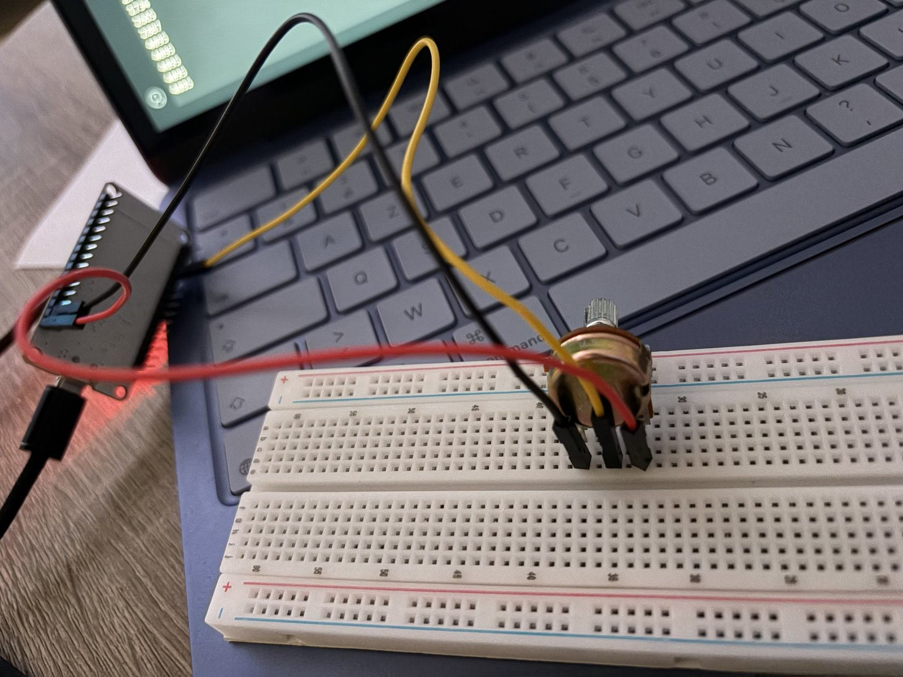

# 04 – Lire un potentiomètre (entrée analogique)

Ce projet lit la position d'un potentiomètre avec l'ESP32 et affiche la valeur (de 0 à 4095) dans le moniteur série de l'Arduino IDE, toutes les 0,5 seconde.

## Matériel
- ESP32 Dev Module
- 1 potentiomètre
- Breadboard + 3 fils

## Câblage
| Patte du potentiomètre | ESP32 |
|---|---|
| Extrémité 1 (fil rouge) | 3,3 V |
| Extrémité 2 (fil noir) | GND |
| Milieu / curseur (fil jaune) | GPIO 34 |

## Comment ça marche
**Le potentiomètre** : la patte du milieu est le curseur. Selon la position du bouton, elle donne une tension entre 0 V et 3,3 V, et c'est cette tension que l'ESP32 mesure.

**La broche 34** : il faut une broche capable de lire une tension analogique (ADC). Les broches 34 à 39 de l'ESP32 sont uniquement des entrées, et la 34 continue de fonctionner quand le Wi-Fi est activé.

**De 0 à 4095** : l'ESP32 convertit la tension en nombre sur 12 bits, soit 2¹² = 4096 valeurs, de 0 (0 V) à 4095 (3,3 V).

**`Serial.begin(115200)`** démarre la communication série entre l'ESP32 et l'ordinateur (par le câble USB), à 115 200 bauds. Le moniteur série doit être réglé sur la même vitesse. **`Serial.println`** écrit chaque valeur puis passe à la ligne, donc les valeurs s'affichent en colonne.

**À ne pas confondre** : `analogRead` lit la tension du potentiomètre (côté analogique), `Serial` envoie le résultat à l'ordinateur pour que je le voie (communication série, en numérique).

## Ce que j'ai appris / ce qui m'a bloqué
Je pensais que les valeurs étaient sur 64 bits, mais c'est 12 bits : même raisonnement que pour le PWM (8 bits = 0 à 255). Je confondais aussi `Serial.begin` avec la lecture du potentiomètre : en fait, il sert seulement à communiquer avec l'ordinateur.
