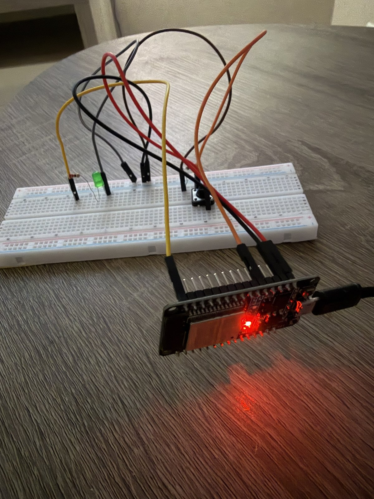

# 05 – Allumer une LED avec un bouton

Ce projet allume une LED tant que le bouton est appuyé, et l'éteint quand on le relâche. L'état du bouton (0 ou 1) s'affiche aussi dans le moniteur série.

## Matériel
- ESP32 Dev Module
- 1 bouton poussoir
- 1 résistance de 10 kΩ (pull-down)
- 1 LED verte + sa résistance
- Breadboard + fils

## Câblage
| Composant | Branchement |
|---|---|
| Bouton, côté 1 | 3,3 V |
| Bouton, côté 2 | GPIO 4 |
| Résistance 10 kΩ | Entre GPIO 4 (même rangée que le bouton) et GND |
| GPIO 23 | Résistance → patte longue (+) de la LED |
| Patte courte (−) de la LED | GND |

## Comment ça marche
**Le bouton** : d'un côté il est relié au 3,3 V, de l'autre à la broche 4. Quand on appuie, le 3,3 V arrive sur la broche, qui lit `HIGH` (1).

**La résistance de pull-down (10 kΩ)** : elle sert à éviter un état flottant, et donc une lecture pas fiable du bouton. Quand le bouton est relâché, elle ramène la broche à 0 V : la broche lit `LOW` (0).

| Bouton | Broche 4 lit | LED |
|---|---|---|
| Relâché | `LOW` (0) | éteinte |
| Appuyé | `HIGH` (1) | allumée |

**`digitalWrite` contre `analogWrite`** : `digitalWrite` ne connaît que 2 états, 1 ou 0 (allumé ou éteint). `analogWrite` couvre beaucoup plus de valeurs (0 à 255) grâce au PWM, comme dans le projet 03.

## Ce que j'ai appris / ce qui m'a bloqué
Mon programme marchait, mais je ne savais pas si c'était grâce à mon montage ou par hasard : sans résistance de pull-down, une broche relâchée peut « flotter » et lire n'importe quoi. J'ai vérifié avec le moniteur série (toujours 0 bouton relâché) et confirmé que ma résistance de 10 kΩ allait bien de la broche 4 vers GND.
